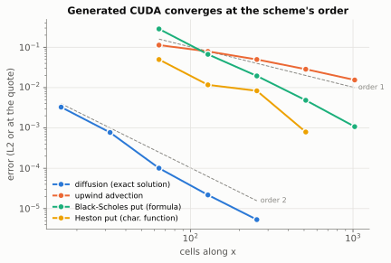
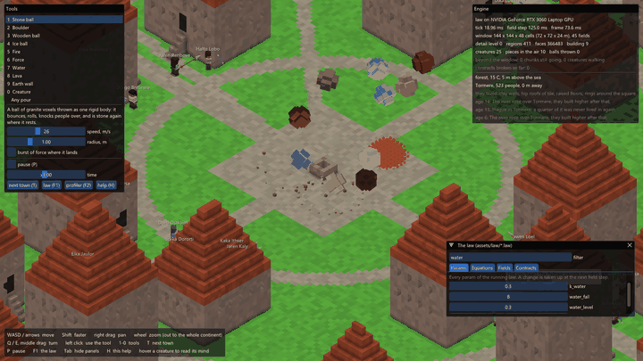
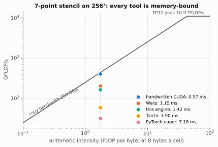
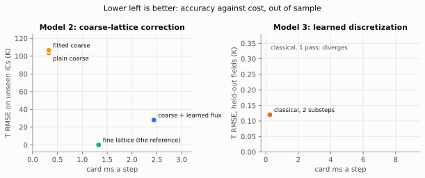
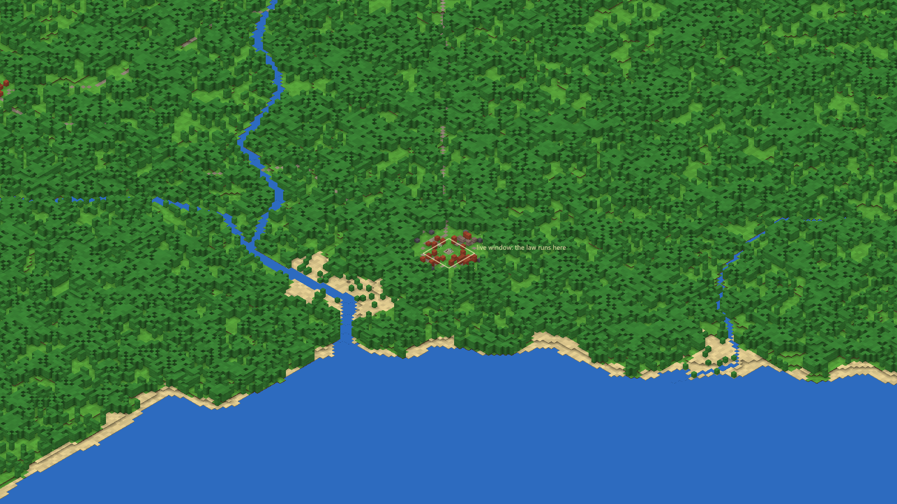

# Field Engine

[](https://github.com/NotTruecCoder/online-physics-cuda/actions/workflows/ci.yml)

**A compiler from PDEs written as text to deterministic CUDA kernels.** A law becomes an SSA IR and one CUDA unit
compiled by NVRTC at run time; the same IR runs on an OpenMP CPU reference and as a JAX twin for `jax.grad`.

```
bench/laws/black_scholes.law            # dV/dtau in x = ln S
  field V init 0 range -1 1000000
  param sig = 0.2
  param r = 0.05
  term black_scholes
    d V = diffuse(0.5*sig*sig, V) + (r - 0.5*sig*sig) * gx(V) - r * V
    max_dt = 0.4 * h * h / (sig * sig)    # stability limit -> substeps

lawc --ir                               # SSA: CSE, folding, stencil radii, fusion plan
  %5  = diffuse %3 %4   [cell, reads 1 away]
  %8  = gx %4           [cell, reads 1 away]
  %12 = sub %10 %11     [cell]          black_scholes: one kernel (ping-pong buffers)

lawc --cuda                             # one translation unit, NVRTC at run time
  extern "C" __global__ void g_t0(float DT) { CELL_HEAD
      const float r0 = v12(x, y, z);  float n = FT[0].now[i];
      d = r0 * DT; if (d != 0.f) { n += d; ch = true; }
      FT[0].next[i] = n; mark(0, ch); }   // the host swaps now/next
```



- **Right:** order 2.0 against exact solutions, CPU = CUDA; a Black-Scholes put 1.7e-3 off the formula at S = 100,
  an American put 1.6e-3 off a binomial tree; Heston by ADI (implicit, `tridiag_x`/`tridiag_y` ops of the language) at
  order **2.0 up to 2048 cells**, 6e-5 off the characteristic function in 512 steps where the explicit scheme needs
  350 000 and floors at 1e-3 ([finance](bench/results/finance.md)).
- **Batched and differentiable:** every z-plane its own option (strike and all five Heston numbers as fields): 2048
  prices of 512 different options in one run; Heston calibrated to a price surface by `jax.grad` through the ADI
  solver ([calibration](bench/results/calibration.md)); **reverse mode generated from the IR** (the adjoint is a law the
  engine runs on CUDA), equal to `jax.grad` to 1e-6 ([adjoint](bench/results/adjoint.md)).
- **A standard benchmark:** PDEBench's 2-D diffusion-reaction at PDEBench's own accuracy, ~70 samples a second on a
  laptop GPU against 3 s a sample for PDEBench's recipe ([pdebench](bench/results/pdebench.md)).
- **Fast enough to compare:** one 7-point stencil on 256³, wall time a step: a handwritten kernel 0.50 ms, this engine
  0.75, Warp 1.67-2.24 (three runs), Taichi 4.7, PyTorch 11 ([frameworks](bench/results/frameworks.md)).
- **Reproducible:** no float atomics, fixed-order reductions: bit-identical runs, bit-identical to the handwritten kernel.



## At a glance

- **Stack:** C++20, CUDA through the driver API + NVRTC loaded at run time (no CUDA SDK to build), inline PTX tensor
  cores (`mma.m16n8k16`), OpenMP CPU reference, JAX twin (`jax.grad` through the solver), bgfx/SDL3 sandbox.
- **Compiler:** law text → SSA IR (CSE, folding, stencil radii, cost-model staging, in-place fusion, ping-pong buffers)
  → one CUDA unit; results stay on the card until read (lazy readback). Implicit solves (`tridiag_x|y|z`), `dt` and
  `let` in the language, so Crank-Nicolson, ADI and RK4 are laws; reverse-mode AD as an IR pass whose output is a law.
- **Learned operators:** conservative, mirror-equivariant, range-limited by construction (ablated: each piece gives
  exactly one guarantee); learned schemes run under contracts checked on the card and are undone on a breach.
- **Results, out of sample against classical baselines:** a coarse-lattice correction cuts error 4x (28 K vs 104 K
  plain, 107 K fitted), a learned discretization is stable at 2x the step but loses to substeps, an online world
  model + MPPI plans as well as a hand-written rule without being told the gradient. Negative results are reported.

## Report

All numbers: one RTX 3060 Laptop GPU (6 GB), 8 CPU threads; reproduce with the script named in each row
([bench/README.md](bench/README.md)). Full tables in [bench/results/](bench/results/).

### Is the solver right?

| check | result | script |
| --- | --- | --- |
| diffusion against the exact solution, refined 16 → 256 | observed order **2.0** (2.09, 2.94, 2.21, 2.04), CPU and CUDA identical to 3 digits | [verify](bench/results/verify.md) |
| upwind advection, refined 64 → 1024 | order **0.52 → 0.89**, approaching the scheme's 1 | [verify](bench/results/verify.md) |
| conserved total over 2190 float32 substeps | relative drift **1.5·10⁻⁶** | [verify](bench/results/verify.md) |
| generated CUDA against a handwritten kernel, same step, 256³ | **bit-identical** (max difference 0) | [perf](bench/results/perf.md) |
| CUDA against the CPU reference, the whole 43-term law | **1.2·10⁻⁷** relative | [perf](bench/results/perf.md) |
| JAX twin against the CPU reference, whole law | **1.8·10⁻⁷** relative | [perf](bench/results/perf.md) |
| two runs on one card | bit-identical (no float atomics; fixed-order compensated reductions) | gate `cuda_parity` |

### What does the generated code cost?

One conduction term on N³ ([perf](bench/results/perf.md)); the first three columns are card time, the last two wall
time a step:

| N³ | copy kernel | handwritten fused kernel | engine, contracts off | engine, contracts on | step, every step read back | step, lazy readback (p50 / p99) |
| --- | --- | --- | --- | --- | --- | --- |
| 128³ | 218 GB/s | 0.10 ms | 0.20 ms | 0.42 ms | 3.4 ms | 0.37 / 0.85 ms |
| 256³ | 255 GB/s | 0.57 ms (236 GB/s) | 1.00 ms | 1.89 ms | 24.6 ms | 1.40 / 2.24 ms |



`perf.py` and `frameworks.py` were rerun 2026-11-12 (the laptop warm, its GPU near 80 °C); Warp's step at 256³ was
0.83, 1.15, 1.67, 2.24 and 2.07 ms in five runs, so ranges are given where runs disagree.

- Generated code was **1.8x the handwritten kernel** at 256³ in that run (1.00 against 0.57 ms; 3x before ping-pong
  buffers). After the two changes below, a rerun on 2026-11-12 with the GPU hot (copy 180 GB/s instead of 255) gave
  0.93 against 0.79 ms: **1.2x**. The table keeps the idle run; what is left is ring addressing and the change flags.
- Contract checks (range, conserved total, every step) cost **+89%** of the faster kernel. A conserved total is a warp
  a row with a fixed shuffle tree, and a changed field sets its flag by a ballot: still bit-reproducible.
- **Readback is lazy** (`Solver::set_lazy_readback`): a step at 256³ went from 25 ms (every changed field copied
  back) to 1.4 ms p50 ([tails](docs/figures/tails.svg)). The world keeps the eager copy; its mesher reads every step.
- The same stencil in other tools, wall time a step at 256³ ([frameworks](bench/results/frameworks.md), every row
  wall time): the handwritten kernel 0.50 ms, this engine **0.75** (1.20 in another run), Warp 1.67-2.24 in the same
  three runs, Taichi 4.7, PyTorch eager 11, Numba on 12 CPU threads 12, NumPy 335. Two changes did it: fields are read
  through `__ldg` (the read-only path a `__restrict__` pointer argument would give; the field table stays in constant
  memory, which costs a kernel argument's load all the same), and `diffuse` with one k skips its six harmonic means
  (k itself, as the CPU's double gives; still bit-identical to the handwritten kernel). That took the term from 1.53
  to 1.02 ms of card time on a loaded run. At 128³ Warp stays ahead (0.20-0.35 against 0.28 ms): there the engine's
  host side of a step (the bounds it reads back for the idle-term test) is most of it. Ring addressing was tried as
  a fast path for an unmoved window and measured as noise; it is out.
- The shipped world law (43 terms, 39 fields, 1 M cells), contracts every step: CPU (OpenMP) 348 ms a step (300–410
  across runs with the laptop's clocks), CUDA **9.6 ms** with lazy readback (36x) and 13.4 ms reading every changed
  field back every step, as the sandbox does (26x) ([where the time goes](docs/figures/profile.svg)).

### Does it solve a problem someone pays for? Option pricing

The same language, not a new code path ([finance](bench/results/finance.md)): Black-Scholes is `diffuse` + `gx` + a
reaction in log-price, an American put adds the early-exercise projection as a penalty term, Heston is two-dimensional
with the mixed derivative as `gx(gy(V))`, every derivative second order (`shift` stencils, the variance flux with exact
face values, a second-order upwind drift; [heston.law](bench/laws/heston.law)).

| problem | reference | result |
| --- | --- | --- |
| European put, 64 → 1024 cells | Black-Scholes formula | order **2.0**; at 1024 cells 1.7·10⁻³ off at S = 100, RMS 1.1·10⁻³ over S = 80..120; CPU = CUDA to the digit |
| American put, 1024 cells | binomial tree, 20 000 steps | 6.0920 against 6.0904 |
| greeks at S = 100, 512 cells | formula | delta, gamma (three-point V_xx) from the lattice, vega, rho by `jax.grad` through every step: within 1.6·10⁻³ relative (gamma the worst) |
| Heston put, the scheme | characteristic function, v0 = 0.2 | a float64 replica of the scheme: 2.3·10⁻³ → 4.8·10⁻⁴ → 1.1·10⁻⁴, order **2.1**; the scheme it replaced: order 0.9 |
| Heston put, the engine | same, v0 = 0.04, 64 → 2048 cells in x | best **−9.9·10⁻⁴** at 512 cells; past that float32 rounding wins: −1.9·10⁻³ at 1024 (87 000 steps), −1.2·10⁻² at 2048 (350 000) |
| Heston surface in one run | same, 64 strikes × 4 maturities | 256 puts at 512 cells, RMS 2.9·10⁻³ (worst 1.1·10⁻², in the money at T = 0.5); 1.17 ms of card time a step for 64 strikes against 0.26 for one: **14x** the throughput a strike |

On Heston, honestly: the first scheme (first-order upwind drift, the harmonic face mean of `diffuse`, where a
variance linear in y wants the arithmetic) was first order, and its 8·10⁻⁴ at 512 cells was, most likely, errors of
opposite sign cancelling (the same scheme is 8.8·10⁻³ off at 512 cells with v0 = 0.2); a bilinear read-out at
(ln 100, v0) also added an O(h²) error whose coefficient jumped with where v0 fell in its cell (bicubic now).
Explicit Euler needs 10⁴–10⁵ steps here, and a float32 cell whose increment is nearly the
same every step is rounded the same way every step: the engine's state, not the scheme, sets the floor. The implicit
scheme below lifts it.

Every step is bit-reproducible on one card, which for a backtest means a rerun gives the same price to the bit.

### Implicit schemes: ADI as a law

`tridiag_x|y|z(lo, di, up, rhs)` is Thomas' algorithm along every line of an axis, the edge cell repeating as `shift`
reads it, so an operator written with shifts and its implicit solve are exactly each other's. With `dt` and `let`
(names inside a term), schemes are text:

- Crank-Nicolson diffusion ([diffusion_cn.law](bench/laws/diffusion_cn.law)) at 33x the explicit step: order
  **2.00, 2.00, 2.00, 2.00** on CPU and CUDA ([verify](bench/results/verify.md)).
- Heston by Hundsdorfer-Verwer ADI ([heston_adi.law](bench/laws/heston_adi.law)): the mixed derivative explicit, x and
  y implicit, θ = 1/2 + √3/6, steps = cells/4. Written first in values, it lost order 2 past 1024 cells (`Y0 = U + dt
  F(U)` at dt var / h² ≈ 136 cancels terms of 10⁴ in float32); in increments (the delta form, which solves for
  changes) it holds:

| cells along x | 64 | 128 | 256 | 512 | 1024 | 2048 |
| --- | --- | --- | --- | --- | --- | --- |
| ADI error, v0 = 0.04 | −9.5e-2 | −3.0e-2 | −5.0e-3 | −1.1e-3 | −2.6e-4 | **−6.4e-5** |
| order | | 1.65 | 2.60 | 2.20 | 2.04 | **2.05** |
| ADI steps / explicit steps | 16 / 328 | 32 / 1 360 | 64 / 5 408 | 128 / 21 824 | 256 / 87 168 | 512 / 349 440 |
| explicit error | −3.4e-1 | −1.1e-1 | −3.3e-3 | −9.9e-4 | −1.9e-3 | −1.2e-2 |

At 2048 cells the ADI run takes 5.5 s of card time against about 150 s for the explicit one, and the self-convergence
order (the lattice against itself, free of the truncated domain) is 2.04. At v0 = 0.2 the error goes 2.5e-2 →
3.2e-5 at order 2.0 to 512 cells, then flattens near float32: 3.2e-5 is 3e-6 of a 12.15 price.

On the card a solve is a stage: its arguments are computed over the lattice first, cell-parallel, then a thread a line
walks them; along x a block takes 32 lines through 32 × 32 tiles in shared memory so the walk reads coalesced. Those
two changes took a Heston step from 3.6 to 1.0 ms for one option and from 85 to 51 ms for 1024.

### Batches: one run, many options

The Heston numbers are static fields in [heston_adi.law](bench/laws/heston_adi.law), so each z-plane is its own option
([finance](bench/results/finance.md)), 256 cells along x, 64 steps:

| options in one run | card ms a step | card ms an option | options a second |
| --- | --- | --- | --- |
| 1 | 0.98 | 62.8 | 16 |
| 16 | 1.71 | 6.8 | 146 |
| 256 | 14.0 | 3.5 | 286 |
| 1024 | 52.5 | 3.3 | **305** |

512 different options (strike 80-120, κ 0.5-3, θ 0.02-0.09, σ_v 0.2-0.6, ρ −0.9 to −0.1, r 0-0.05, v0 0.02-0.1, Feller
holding) × 4 maturities: 2048 prices in one run of 1.4 s of card time, RMS 3.8e-3 against the characteristic function
(the 256-cell row's accuracy). One option alone keeps the card idle: below ~16 options the step is the latency of the
line walks, not the cells.

### Calibration through the PDE

Heston's κ, θ, σ_v, ρ, v0 fitted to 27 puts (9 strikes × 3 maturities) by L-BFGS-B, the loss and its gradient by
`jax.value_and_grad` through every ADI step of the JAX twin, strikes as z-planes, the variance lattice moving with
σ_v ([calibrate.py](bench/calibrate.py), [calibration](bench/results/calibration.md)):

| | κ | θ | σ_v | ρ | v0 |
| --- | --- | --- | --- | --- | --- |
| true | 1.5 | 0.04 | 0.3 | −0.7 | 0.05 |
| start | 2.5 | 0.06 | 0.45 | −0.3 | 0.03 |
| fit through the PDE, 128 cells | 1.77 | 0.0402 | 0.272 | −0.83 | 0.0499 |
| fit through the PDE, 256 cells | **1.56** | **0.0400** | **0.293** | **−0.73** | **0.0500** |
| the characteristic function fitted itself | 1.50 | 0.0400 | 0.300 | −0.70 | 0.0500 |

The gradient agrees with central differences of the same float32 loss to 3e-4-6e-3 and costs 2.9-3.9 losses for all
five numbers (central differences cost 10). What is left between the fit and the truth is the lattice's pricing
error turned into the least identifiable numbers (κ, ρ), and it shrinks with the lattice. With 0.1-cent noise on every
price the 256-cell fit is κ 1.57, ρ −0.73.

### Reverse mode in the IR

`lawc --adjoint` turns a term into its adjoint law: one reverse sweep over the term's SSA instructions, each adding
its local derivative times its adjoint to its arguments', stencils to their transposes (`shift_t`, `gx_t`; `lap` and
the flux-form `diffuse` are symmetric). The output is law text, so the adjoint runs wherever laws run; `lawc --vjp`
runs the primal forward, keeps the states, and runs the adjoint backward ([adjoint.py](bench/adjoint.py),
[adjoint](bench/results/adjoint.md)):

| check | CPU | CUDA |
| --- | --- | --- |
| <op(a), b> = <a, op_t(b)> for shift, gx, gy, gz on 7 × 6 × 5 | 3.4e-7 | 3.4e-7 |
| Black-Scholes, 410 steps: dV(100)/dV0, /dσ, /dr against `jax.grad` | 3.1e-7, 1.2e-6, 2.4e-6 | 2.5e-7, 1.2e-6, 2.5e-6 |
| vega 37.5123, rho −41.909 against the formula's 37.5240, −41.890 | 3.1e-4, 4.4e-4 (the lattice's own error) | same |
| Heston, 328 steps, every cell weighed: dL/dV0, κ, θ, ρ, r, σ_v | ≤ 2.7e-6 | ≤ 2.1e-6 |

Two implementations of AD (this pass over the C++ IR, and JAX over the Python twin) agree to float32 rounding. Not
yet: checkpointing (the backward pass keeps every primal state on the host and uploads each), and adjoints of adv,
tridiag, the matter-moving ops and nets (refused by name).

### A standard benchmark: PDEBench

PDEBench's 2-D diffusion-reaction (FitzHugh-Nagumo, 128², t ∈ [0, 5], 101 frames, its `diff-react.yaml`) is
[diff_react.law](bench/laws/diff_react.law): PDEBench's spatial operator exactly (zero-flux walls), RK4 written in
`let`s, a sample a z-plane. Against the same method of lines at tight tolerance (DOP853, rtol 1e-10), nRMSE over every
frame ([pdebench](bench/results/pdebench.md)):

| solver | nRMSE | samples a second |
| --- | --- | --- |
| PDEBench's recipe (solve_ivp RK45 at its defaults, one CPU core) | 3.0e-5 | 0.3 |
| engine, RK4, 7 substeps a frame (cfl 0.15), 1024 samples in one run | 3.5e-5 | **~70** (card time) |
| engine, RK4, 14 substeps a frame | 1.6e-6 (order 4.5) | twice the substeps (not timed apart) |

So PDEBench's 1000-sample set is about 15 s of card time at its own accuracy, or 20x more accurate at twice that; the
script also writes PDEBench's HDF5 layout (`--hdf5`). A neural operator trained on it is not part of this repository.

### Which piece of the architecture gives which guarantee?

Random, untrained weights (20 draws, worst shown), each piece removed in turn ([ablations](bench/results/ablations.md)):

| operator | variant | total drift | draws leaving the range | mirror error | offset error |
| --- | --- | --- | --- | --- | --- |
| flux | full | 6·10⁻⁸ | 0/20 | 1·10⁻⁴ K | |
| flux | no limiter | 2·10⁻⁷ | **13/20** | 1·10⁻⁴ K | |
| flux | no antisymmetry | 5·10⁻⁷ | 0/20 | **142 K** | |
| flux | no flux form (learned source) | **160** | 14/20 | 95 K | |
| ldiffuse | full | 5·10⁻⁶ | | 0 | 6·10⁻⁴ K |
| ldiffuse | no mean removal | 2·10⁻³ | | 0 | **926 K** |
| ldiffuse | no antisymmetry | 2·10⁻⁶ | | **43 K** | 6·10⁻⁴ K |

Conservation comes from the flux form, range from the limiter, layout symmetry from antisymmetry, and offset
invariance from mean removal. Each holds for any weights; no training is involved.

### Do the learned models help, out of sample?

**Model 2, a learned correction for a lattice twice as coarse** (burning front; trained on 6 initial conditions, tested
on 6 unseen ones and 2 out of distribution; 3 training seeds; [model2](bench/results/model2.md)):

| method | T RMSE, unseen ICs | front position error at 30 s |
| --- | --- | --- |
| plain coarse | 104 ± 51 K | 39 ± 24 m |
| coarse with 5 coefficients fitted (same data, loss, optimizer) | 107 ± 50 K | 7.1 ± 3.7 m |
| **coarse + learned flux** | **28 ± 7 K** | **3.1 ± 3.6 m** |

Out of distribution: a full uniform fuel load, 12 K against 160 K (plain) and 188 K (fitted); sparse fuel where the
front dies, all three within 5 K. Card time: coarse + learned flux **3.0 ms**, while the fine lattice costs **1.4 ms**
([perf](bench/results/perf.md)).
It is more accurate than the classical options at the same resolution, but here it costs more than running the fine
lattice.

**Model 3, a learned discretization at twice the explicit step, under guard** (heat; 3 seeds;
[model3](bench/results/model3.md)):

| set (100 steps) | classical, 2 substeps | classical, 1 pass | learned, 1 pass |
| --- | --- | --- | --- |
| held-out fields | 0.12 K | diverges 24/24 | 0.26 ± 0.07 K |
| OOD smooth modes | 0.06 K | diverges 24/24 | 0.14 ± 0.03 K |
| OOD sharp boxes | 0.12 K | diverges 24/24 | 0.19 ± 0.04 K |

It is stable where the explicit scheme at that step blows up, with no new extremes (overshoot 0). The guard undoes
0/640 trained steps and 44/640 untrained ones, and no violation reaches the world. But it is **2x less accurate** than
the 2 classical substeps it replaces and **27x more expensive** (12.0 ms against 0.44 ms of card time a step on
1024², [perf](bench/results/perf.md), after an unrolling fix in the net code generator that made it 12x faster).
This is a negative result for the scheme and a working demonstration of the guard.



**Model 1, a world model learned online + MPPI** (64 foragers, 5 world layouts, 30 episodes;
[mind](bench/results/mind.md)). Cost a decision, lower is better:

| still | random | hand-written rule (reads the true gradient) | **MPPI, learned model** | MPPI, true dynamics (ceiling) |
| --- | --- | --- | --- | --- |
| 0.95 ± 0.12 | 0.92 ± 0.12 | 0.49 ± 0.07 | **0.50 ± 0.04** | 0.32 ± 0.07 |

Planning through the learned model matches the hand-written rule without being told the gradient, and it closes 70%
of the gap from random to the true-dynamics ceiling. As a simulator it is weak: one-step R² is 0.36 on its own world
and ≈0 on an unseen layout. It predicts fear worse than a constant, because the planner keeps away from danger and the
replay holds few such transitions. Its 12-step cost forecast is worse than persistence. Plan 12 ms for 64 agents ×
256 futures × 12 steps on the card.

### What this adds up to

- The compiler is correct: the right orders of convergence, bit-identical to a handwritten kernel, 1e-7 against the
  CPU and JAX references. It is close to, not at, the bandwidth floor: a term runs at 1.6-1.9x a handwritten kernel
  (run to run) and a step (lazy readback) at 1.2x Warp's on the same stencil.
- It prices options: Black-Scholes at second order, the American put close to its tree, Heston by ADI at second order
  to 2048 cells in hundreds of steps (the explicit scheme's float32 floor at 10⁻³ named, not hidden); hundreds of
  different options a second in one run; calibration by `jax.grad`; greeks by the engine's own reverse mode, on CUDA.
- Learned operators with built-in guarantees work as designed, and the guard catches what the law declares (only
  that: an oscillation inside the declared range passes it; see gate `guarded`).
- Of the three models, only the coarse-lattice correction clearly beats its classical alternatives out of sample, and
  even it costs more than running finer at this scale. The learned discretization loses to plain substeps. The world
  model plans well but does not generalise as a simulator.
- Not done: checkpointed reverse mode (states kept on the card) and adjoints of tridiag and adv; a neural operator
  trained on the PDEBench data the engine generates (the two negative model results stand as they are); a faster
  tridiagonal solve for one small option (cyclic reduction instead of a thread a line); compensated float32 state;
  multi-GPU; a SIMD CPU backend; flowing rivers; a learned simulator over the engine's own fields with the guard as its
  safety net (the natural next model).
- Gates: all pass on Windows; CI runs the compiler's and the fast world gates on Linux on every push, and the orders
  of convergence, the finance PDEs (ADI among them) and the IR's reverse mode against `jax.grad` on the CPU reference,
  each asserted (`verify.py`, `finance.py --cpu`, `adjoint.py`); the five slow world gates weekly ([slow-gates](.github/workflows/slow-gates.yml)). GCC found a dangling
  reference MSVC hid (WorldModel, fixed).

## What it is

```
law text (assets/law/*.law) ──► parser ──► expression trees ──┬─► CPU solver (OpenMP, the reference)
                                                              └─► SSA IR (CSE, folding, stencil radii, fusion plan)
                                                                    ├─► CUDA codegen ──► NVRTC ──► kernels (main backend)
                                                                    ├─► JSON ──► tools/lawjax (jnp, jax.grad, training)
                                                                    └─  (HLSL codegen ──► D3D11: fallback, no nets)
```

```
field T     init 290  range 0 8000  unit K       # a field and its contracts (checked on the card)
param k_rock = 0.6
term conduction
  d T = diffuse(k_rock * solid + k_air * (1 - occ), T)
  conserves T
  max_dt = 0.15 * h * h / k_rock                 # the author's stability limit, turned into substeps
derive sdf = distance(occ)                       # exact signed distance transform

net front_fix in 4 hidden 32 32 out 1 act tanh half       # `half`: tensor cores
term front_fix
  d T = flux(front_fix, T, fuel)                 # learned face flux: conservative, antisymmetric, range-limited

term heat
  d T = diffuse(k, T)
  max_dt = 0.15 * h * h / k
  learned d T = ldiffuse(heat_ld, k, T)          # learned discretization at a larger step, under guard
  learned max_dt = 0.3 * h * h / k

term crank_nicolson                              # implicit: no max_dt
  let a = 0.5 * k * dt / (h * h)
  d T = (tridiag_x(0 - a, 1 + 2 * a, 0 - a, T + a * (shift(T, 1, 0, 0) - 2 * T + shift(T, -1, 0, 0))) - T) / dt
```

```
lawc --adjoint adj.law --term black_scholes      # reverse mode, as a law
  let av__4 = (av__11 * r) + gx_t(av__8) + diffuse(pv__3, av__5)
  d V__adj = av__4                               # V_bar = A + dt (dR/dV)^T A
  d sig__adj = av__1                             # its total over the lattice: dL/dsig
```

- **A compiler, not an interpreter.** One immutable SSA graph for the whole law (on the shipped law 340 of 622
  instructions are found twice and kept once), constant folding with the reference's semantics, stencil radii, a cost
  model deciding what to recompute and what to store, in-place fusion when there is no read-after-write hazard (34 of
  43 terms run as one kernel). CUDA C → NVRTC → CUBIN, cached by content hash, `--fmad=false` so the arithmetic is
  the reference's.
- **Deterministic GPU numerics.** No floating-point atomics. Totals and reductions are two-level, Neumaier-compensated,
  in a fixed order (a warp a row, a fixed shuffle tree); contract checks count with integers and find the first bad
  cell with `atomicMax(~i)`.
- **Hand-written tensor-core code.** Nets in the law run through `mma.sync.aligned.m16n8k16` in inline PTX (no CUDA
  headers): weights pre-packed into fragment order on the host; one layer's fp32 accumulators are, register for
  register, the next layer's f16x2 A fragments. Fused forward+backward training kernels without atomics (backward
  checked against finite differences, 6·10⁻⁵).
- **Learned operators with guarantees by construction.** `flux`: a face flux (conservative for any weights),
  antisymmetrised (mirror-equivariant), limited per face (stays in the declared range). `ldiffuse`: a 4-cell face
  stencil whose weights a net gives, mean-removed (sees only differences) and antisymmetrised; an untrained net is
  `diffuse` exactly.
- **Guarded execution.** A learned scheme runs at its own larger step; its term's contracts (range, finiteness,
  conservation) are checked on the card; a breach restores a device-side snapshot and reruns the classical scheme.
- **Differentiable twin.** `tools/lawjax` rebuilds every IR instruction in `jax.numpy` with the engine's semantics;
  `jax.grad` through unrolled solver steps trains models against data the C++ reference produced.
- **World model + MPPI** (`src/field/mind`): a creature's `plan = ...` and `observe ...` lines; a neural ODE on its
  observations learned online (replay, GPU training), MPPI with a block an agent and a thread a future, the law's plan
  line compiled into the kernel as the cost, noise a hash of (agent, tick, sample, step).
- **Systems.** Driver API and NVRTC loaded at run time; ring-addressed lattice so a moving window uploads only arriving
  chunks; pinned readback of changed fields only; CUDA-event profiler per term; a law hot-reloaded while the world runs.
- **Testing as falsification.** 21 gates (`src/tests`, `demo/tests`) state claims, each naming the mutation of the
  engine that makes it fail; those mutations were run.

`src/field/FIELD.md` is the design document (the language, contracts, the IR, the backends, the open world, NPCs).

## Demo: the world it runs

The engine drives a voxel world (`demo/world`: `Playground`, `WorldMap`, `Terrain`, `People`; `demo/sandbox`): heat,
combustion, phase changes, water, lava, structural support and light as 43 terms over 39 fields; rigid voxel pieces;
a 262 × 262 km generated continent in layers (plates, climate, drainage, a 16-age history, towns built by culture and
changed by events); creatures and townspeople whose minds are lines of the same language. No line of C++ says
"hunter" or "prey": it all goes through fields. This is the demonstration and the stress test of the compiler, not a
validated physical model: its laws are game physics.



## Build and reproduce

The engine, `lawc`, the benchmarks and the gates need only a C++20 compiler and OpenMP; the sandbox also needs vcpkg
(SDL3, Dear ImGui, bgfx, glm). CUDA needs only the NVIDIA driver and an NVRTC DLL (from `CUDA_PATH`, next to the
executable, a PyTorch install, or `FIELD_NVRTC`). `FIELD_BACKEND=cuda|hlsl|cpu` chooses the backend.

```bash
cmake --preset core && cmake --build --preset core && ctest --preset core   # Windows, engine only
cmake --preset linux-core && cmake --build --preset linux-core               # Linux (CPU; CUDA if a card is there)
cmake --preset dev && cmake --build --preset dev                             # everything, with VCPKG_ROOT set
```

```bash
pip install -r requirements.txt
python bench/verify.py && python bench/perf.py && python bench/ablations.py
python bench/model2_front.py && python bench/model3_heat.py && python bench/mind.py
python bench/finance.py && python bench/frameworks.py && python bench/plots.py
```

`lawc` is the compiler on the command line (from `build/`): `--ir` (the IR listing), `--cuda FILE` (the generated
translation unit), `--scene S --steps N --backend cuda --profile` (per-term profile), `--compare` (CPU against CUDA),
`--dump DIR` / `--init DIR` (states as float32), `--json FILE` (timings).

Sandbox (`build/Release/sandbox.exe`): WASD/wheel/right-drag to move and zoom (to the whole continent), 1–0 to throw
balls of stone, wood, ice, pour fire, water, lava; F1 the law (every param live, every equation as the solver runs
it), F2 the profiler (per-term card time, learned steps undone).

## Related work

The ideas are not new one by one; the contribution is putting them in one compiler with one IR, checked against one
reference. Learned discretizations: Bar-Sinai et al. 2019 (model 3 is in that line); solver-in-the-loop training and
learned corrections for coarse grids: Um et al. 2020, Kochkov et al. 2021 (model 2); structure-preserving learned
fluxes: conservative finite-volume networks. DSLs to GPU for simulation: Taichi, NVIDIA Warp, Devito, Halide, Firedrake
(these are more general; on the one stencil measured Warp is faster than this engine and Taichi slower; this engine's
distinctive parts are declared contracts checked on the card, the guarded learned schemes and the bit-reproducible
kernels). Learned dynamics + MPPI: PETS (Chua et al. 2018), Williams
et al. 2017.

## Layout

| path | what |
| --- | --- |
| `src/field/` | the compiler: law language, CPU reference solver, contracts |
| `src/field/ir/`, `src/field/cuda/` | the IR; CUDA codegen, NVRTC loading, the CUDA backend, network kernels |
| `src/field/nn/`, `src/field/mind/` | networks of the law (CPU reference); the world model and MPPI planner |
| `tools/lawc/`, `tools/lawjax/` | the compiler CLI; the JAX twin and parity check |
| `bench/` | verification, performance, ablations, the three models, finance, the framework comparison, the figures |
| `src/tests/` | the compiler's gates |
| `demo/world/`, `demo/tests/` | the demo world (bodies, rays, map, people, items, melee) and its gates |
| `demo/render/`, `demo/sandbox/` | bgfx renderer and the interactive sandbox |
| `assets/law/` | the laws (world, magic, life, people, map, pours; bench laws) |

## License

MIT, see [LICENSE](LICENSE).
